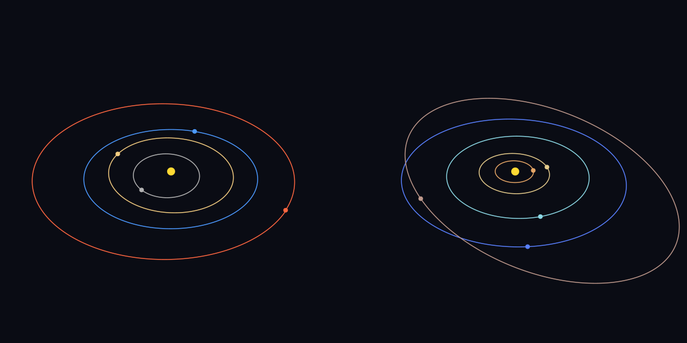

orbits
======

The solar system as a 3D Newtonian n-body problem, integrated in f64 and checked against JPL
Horizons.



The Sun, the eight planets, the Moon and Pluto, from their Horizons state vectors at J2000
(2000-01-01 12:00 TDB), in barycentric ecliptic J2000 coordinates, AU and days. Mars through Pluto
are system barycentres, since their GM is the planet's and its moons' together.

```
git clone https://github.com/sysl-lang/quaternion ../quaternion
git clone https://github.com/sysl-lang/duckdb ../duckdb
sysl build . -o orbits --include-path duckdb=/opt/homebrew/include --link-path /opt/homebrew/lib
sysl test . --include-path duckdb=/opt/homebrew/include --link-path /opt/homebrew/lib
```

`quaternion` and `duckdb` are not released yet, so they are `path` dependencies on sibling
checkouts. cairo needs `brew install cairo` (or `libcairo2-dev`), DuckDB `brew install duckdb`;
DuckDB ships no `.pc` file, so every build names its directories. SQLite and libcurl are found by
pkg-config.

**`sysl build .` and `sysl run .` are refused by sysl 0.1.0-alpha.12** with `no module is called
'sh.sysl.png'`: they analyse the `@tests` files, which import the test-only `png`, although the
packages reference says every build but `sysl test` drops them. Until the compiler is fixed the
program builds from a copy without `tests.sysl` and `catalog_tests.sysl`.

Commands
--------

| command | what it does |
|---|---|
| `orbits` | integrate from J2000 and write `orbits.png` |
| `orbits --compare` | each body's distance from Horizons at +30 d, +1 y, +10 y |
| `orbits --bench STEPS` | time the force loop (`bench/force.c` is C's) |
| `orbits seed` | make the catalog `orbits.db` from the replies in `fixtures/horizons/` |
| `orbits add NAME` | fetch `NAME` from Horizons at the catalog epoch, with its GM where Horizons knows it, and insert it |
| `orbits add --query SQL` | insert the small bodies `SQL` selects from the `sbdb` table |
| `orbits import FILE` | import an SBDB query reply (a file, or a URL DuckDB can read) into `orbits.duckdb` as `sbdb` |
| `orbits simulate DAYS` | integrate catalog bodies, recording `(t, body, x, y, z)` into `orbits.duckdb` |
| `orbits query SQL` | run SQL over `orbits.duckdb`, printing CSV |

`simulate` takes `--dt D` (days, 0.05), `--every K` (record every K steps, 20), `--bodies A,B,…` or
`--where SQL` (a condition on the catalog; all bodies by default) and `--parquet FILE`. A session:

```
orbits seed
orbits add "Ceres;"
orbits add "Apophis;"
curl -o sbdb.json "https://ssd-api.jpl.nasa.gov/sbdb_query.api?fields=spkid,full_name,pdes,name,epoch,e,a,q,i,om,w,ma,n,GM,diameter&sb-kind=a&full-prec=true"
orbits import sbdb.json
orbits add --query "SELECT * FROM sbdb WHERE diameter > 300"
orbits simulate 3650 --bodies "Sun,Earth,Moon,Ceres" --parquet decade.parquet
orbits query "SELECT p.t, sqrt((p.x-q.x)^2 + (p.y-q.y)^2 + (p.z-q.z)^2) AS d FROM trajectory p JOIN trajectory q ON p.t = q.t WHERE p.body = 'Earth' AND q.body = 'Ceres' ORDER BY d LIMIT 1"
```

A name is sent to Horizons as typed and stored without a trailing `;`. `Ceres` alone is the
major-body record, which has no GM in its header; `Ceres;` is the small-body record, which does. A
name Horizons does not know fails with Horizons' own message; one that matches several bodies
fails listing them, and `orbits add 499` then names one by its ID#.

The catalog
-----------

One SQLite table, `bodies(name, naif_id, gm, radius, parent, epoch_jd, x, y, z, vx, vy, vz, source,
fetched_at)`:

| column | |
|---|---|
| `name` | the primary key; `add` replaces a body of the same name |
| `naif_id` | NAIF id where the reply names one (`Mars (499)`), the SPK id for a small body; else NULL |
| `gm` | km^3/s^2, as Horizons and the SBDB publish it; 0 for a massless test particle |
| `radius` | km, from the reply's header or half the SBDB diameter; NULL where neither says |
| `parent` | `Sun`, `Earth` for the Moon, NULL for the Sun and for bodies `add` fetched |
| `epoch_jd`, `x`…`vz` | the state at Julian date (TDB) `epoch_jd`: barycentric ecliptic J2000, AU and AU/day |
| `source`, `fetched_at` | which ephemeris or elements the state came from, and the time stamp of the Horizons reply |

Every body in a system shares one epoch, the catalog's (the Sun's, J2000 once seeded); `simulate`
refuses a mixture. The seed is the stage-1 system to the bit, so every result below holds for a
system loaded from the catalog.

A small body from `add --query` is placed by **two-body motion** from its SBDB osculating elements
(epoch 2026) back to the catalog epoch, under the Sun alone (GM = k², Gauss's constant): good for
seeing where the belt is, not for an ephemeris, since 26 years of the planets' pull are left out. `orbits add "<name>;"` asks Horizons for the integrated state instead.

Small bodies and trajectories (DuckDB)
--------------------------------------

The SBDB query API answers JSON (`fields` and `data` arrays) and nothing else, so the import is one
`read_json` that unnests the rows into a typed `sbdb` table: `spkid`, `full_name`, `pdes`, `name`,
`epoch`, `e`, `a`, `q`, `i`, `om`, `w`, `ma` (degrees), `n` (degrees/day), `gm`, `diameter`. The
committed sample, `fixtures/sbdb/sample.json`, is the first 1000 numbered asteroids (`&limit=1000`);
the full catalog, 1.5 million rows, is the `curl` above.

`simulate` appends `trajectory(t, body, x, y, z)` through DuckDB's appender; `--parquet` writes it
with `COPY … (FORMAT parquet)`.

Where the data comes from
-------------------------

State vectors and GMs are from [JPL Horizons](https://ssd.jpl.nasa.gov/horizons/) (the DE441
planetary ephemeris and JPL's small-body solutions), orbital elements from the
[JPL Small-Body Database](https://ssd.jpl.nasa.gov/tools/sbdb_query.html), both run by the Solar
System Dynamics group of NASA's Jet Propulsion Laboratory, Caltech. The data are public and free to
use; JPL asks that results be credited to it and that clients not load its APIs heavily, which is
why the tests read recorded replies (`fixtures/`) and never the network.

What is in it
-------------

| file | what |
|---|---|
| `system.sysl` | the bodies, the pairwise force loop, energy, angular momentum, barycentre |
| `integrate.sysl` | RK4, leapfrog (velocity Verlet) and Yoshida's 4th-order symplectic composition, switchable |
| `kepler.sysl` | Kepler's equation (elliptic and hyperbolic) by Newton, and elements ↔ state vectors |
| `render.sysl` | a perspective camera oriented by a quaternion, drawing the tracks with cairo |
| `horizons.sysl` | the Horizons fixtures, with the exact query; the raw replies are in `fixtures/horizons/` |
| `reply.sysl` | a Horizons reply read (state, GM, radius, its refusals), and the query `add` sends through libcurl |
| `catalog.sysl` | the SQLite catalog: schema, seed, insert, choosing bodies by name or SQL |
| `smallbody.sysl` | the SBDB import into DuckDB, and elements to a catalog row |
| `trajectory.sysl` | recording through the appender, Parquet export, queries |
| `failure.sysl` | one error type, from SQLite's, DuckDB's, libcurl's and the filesystem's |
| `bench/force.c` | the same benchmark in C |

The tests, and why their tolerances widen with time
---------------------------------------------------

`sysl test .` runs 37 tests against oracles that share no code with the program: Horizons for where
the bodies are, conservation laws, the closed-form two-body solution, Kepler's equation solved by
bisection, and an independent PNG decoder (sysl-lang/png) for the image cairo writes.

The 14 in `catalog_tests.sysl`: the catalog round-trip with NULLs; the seeded system equal to the
stage-1 one bit for bit, and still bit-equal after 30 days of integration; choosing bodies by name and
by SQL, and the refusals; `add` from recorded replies (Ceres's state, GM, radius and source, the GM
and radius spellings of three headers, an unknown name with Horizons' message, an ambiguous one with
its ten matches, the escaped query); the SBDB sample's 1000 rows with Ceres's elements equal to the
JSON's text; Ceres's elements turned into a state within 5e-8 AU and 5e-10 AU/day of Horizons at
their epoch (numpy gets 2.7e-8 and 1.0e-10 from the same numbers); `add --query`; a recorded
Earth–Moon closest approach found by SQL equal, as printed, to the one computed in sysl; the Parquet
export read back row for row; and DuckDB's own sentences for bad SQL, the same as its CLI's.

Against Horizons, integrating with Yoshida at 0.05 day:

| after | every body within | Jupiter to Pluto within |
|---|---|---|
| 30 days | 2e-7 AU | 1e-9 AU |
| 1 year | 2e-6 AU | 2e-8 AU |
| 10 years | 4e-5 AU | 2e-6 AU |

The integration error is far below these: Yoshida and RK4 agree with each other to 1e-9 AU at ten
years. What sets the floor is what the model leaves out, and its effect grows with time:

- **General relativity.** Mercury's perihelion advances 43″ a century more than Newton says. It is
  the largest error at every date: 6e-8 AU at 30 days, 1.2e-5 AU at ten years.
- **The asteroids.** DE441 integrates Ceres, Vesta, Pallas and hundreds more; they pull the inner
  planets by about 1e-6 AU over a decade (the Earth is 4e-6 AU off at ten years, and a test asserts
  it is off by that much and no more).
- **Point masses.** The Earth and Moon are not spheres to each other, and the Sun's oblateness and
  the tides are absent.

The outer planets feel almost none of this, which is why they get a tolerance a hundred times
tighter.

The rest:

- **Conservation over 1000 years** (one-day steps, the Moon left out): Yoshida's relative energy
  error stays below 1e-7 and leapfrog's below 1e-5; both conserve angular momentum to 1e-13. RK4's
  energy error is over 100× Yoshida's and grows with time, and it loses angular momentum.
- **Reversibility**: leapfrog 20,000 steps forward and 20,000 back returns within a few ulps per
  step; RK4 does not.
- **Momentum**: the barycentre moves in a straight line.
- **Kepler**: against bisection, elliptic and hyperbolic, near-parabolic (e = 0.999, e = 1.0001) and
  huge anomalies; NaN outside the domain (e = 1, e < 0, NaN), as `sysl.math` answers; circular,
  equatorial, polar and retrograde conventions; elements → state → elements round trips.
- **Two-body**: a circular, an eccentric (e = 0.5), a nearly parabolic (e = 0.95) and a hyperbolic
  orbit integrated against the closed form, and halving the step divides the error by 16, which is
  the check that Yoshida is fourth order.
- **The picture**: the camera's projection, chosen pixels (the Sun, the Earth and Jupiter where the
  camera puts them at J2000), and the PNG decoded by `png` agreeing with what cairo drew.

Speed
-----

The force loop against `bench/force.c` at `-O2`, one million Yoshida steps of the 11-body system
(three force evaluations a step, 55 pairs each), on an Apple M-series machine:

| | time |
|---|---|
| C, `cc -O2` | 0.27 s |
| C, `cc -O2 -ffp-contract=off` | 0.30 s |
| sysl, `optimization = "2"` | 0.36 s |

sysl is 1.2× the C program that does the same arithmetic. Against `-ffp-contract=off` the final
state is **bit-identical**: sysl does not fuse a multiply and an add into an FMA, so it rounds every
operation as written, and clang's default does fuse them.

License
-------

ISC.
